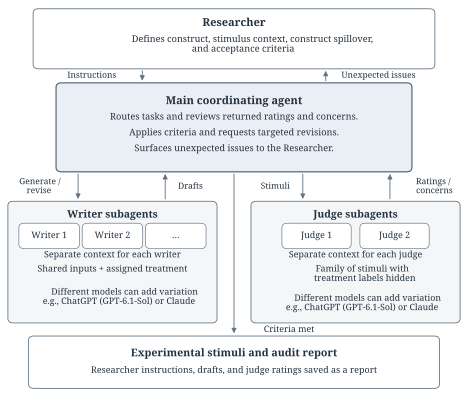

# Beyond Stimulus Sampling

A guided harness for constructing experimental messages and auditing **construct spillover**: changes in attributes beyond the construct a researcher intends to manipulate.

Stimulus sampling addresses variation across messages. It does not establish that those messages isolate the intended construct. This package helps researchers define the construct boundary, generate multiple message families, examine changes in other attributes, and revise the messages against a recorded study specification. It is reusable research infrastructure: the constructs, contexts, treatment levels, and screening rules live in a study file rather than in the generation code.

This is a private research prototype by David Hagmann and Zachary Wojtowicz. Model screening supports stimulus development; human validation remains necessary.

The package accompanies [*Beyond Stimulus Sampling: A Harness for Designing and Auditing Experimental Stimuli*](manuscript/beyond_stimulus_sampling.pdf). The [blinded review copy](manuscript/beyond_stimulus_sampling_blinded.pdf), editable Quarto sources, references, figure assets, and minimal analysis data are included. See the [manuscript reproduction instructions](manuscript/README.md).



## Start with your research question

Requires Python 3.10 or later. The package has no runtime Python dependencies. For live generation, install and authenticate a supported model CLI, or connect a provider through the [command adapter](docs/providers.md).

```sh
python3 -m venv .venv
source .venv/bin/activate
python -m pip install -e .
bss init --output study.json
```

The wizard first asks **what construct you want to manipulate** and **in what context**. It generates definitions, rating anchors, and candidate related constructs, then asks you to classify each candidate:

| Researcher decision | What the harness does |
| --- | --- |
| Part of the same construct | Includes it as a facet of the focal construct. |
| Construct spillover | Rates it separately and screens for unintended differences. |
| Another experimental factor | Generates the full combination of its ordered levels with the other factors. |
| Expected consequence | Measures it diagnostically; changes do not determine acceptance and it is absent from writer objectives. |
| Outside scope | Records the decision and rationale without adding a measurement dimension. |

You can edit the suggestions and add constructs the model missed. You then specify the scenarios, shared substantive content, number of families, length, providers, and assessment criteria. The wizard records your rationale for each classification and saves answers after every step. To continue an interrupted setup, repeat the command with `--resume`.

## Generate and inspect messages

```sh
bss plan study.json --output study-planned.json \
  --content-pool-size 15 --content-per-family 5 --style-pool-size 8
bss review study-planned.json --complete
bss run study-planned.json --output runs/pilot
bss report runs/pilot
bss validate runs/pilot
bss export runs/pilot --output runs/pilot/messages.json
```

Open `runs/pilot/report.html` to inspect the messages, individual judge ratings, target contrasts, spillover contrasts, failures, and revision history. Each family contains every combination of factor levels for one shared scenario. Multiple independently generated families provide stimulus sampling within each scenario; additional scenarios broaden the intended stimulus population.

`bss plan` proposes a pool of substantive points and a pool of organizational styles from the source material supplied for each context. It saves those suggestions for researcher review; it does not verify their factual accuracy. The researcher can edit them before accepting the planned study. For each family, the engine samples points without replacement and selects a style, then supplies the same draw to every treatment cell. New draws across families introduce variation in content and organization. The frozen manifest records each draw, and revisions keep that draw fixed. A study without pools uses the original shared blueprint for every family. See the [pool and sampling specification](docs/sampling.md).

Writers receive separate requests for each cell. Judges see the complete family in a shuffled order, with neutral message IDs and no condition assignments. Failed cells are revised; the whole family is evaluated again. Running the same command resumes from saved calls and completed attempts, using the same frozen study and code. Changing the design requires a new run directory.

Acceptance means **model-screened**, not human-validated. The export preserves that distinction and includes any outstanding human-review flags. Incomplete corpora require an explicit `--allow-partial` export. The model judges' evaluations of consequences are not participant outcomes.

## Try it without a model account

```sh
bss demo --output demo-run
bss validate demo-run
```

This **synthetic software demonstration** uses fixed workplace messages and invented ratings. It shows an initial transparency manipulation that also changes interpersonal consideration, followed by a revision that passes the specified checks. It makes no empirical claim and performs no model calls. Live calls use your own provider account and its applicable usage limits or charges.

## Adapt it to another study

Run `bss init` again with a different construct and context. You can also inspect the [certainty–brashness example](examples/certainty-brashness.json), which illustrates two independently manipulated dimensions, or the [organizational transparency example](examples/organizational-transparency.json).

The [pooled certainty–brashness example](examples/certainty-brashness-pooled.json) also includes hand-written content and style pools for a hypothetical remote-work pilot. It illustrates the sampling format without requiring an initial planning call. The entries still need researcher review.

Examples require researcher review before generation:

```sh
bss review examples/organizational-transparency.json --complete
bss run examples/organizational-transparency.json --output runs/transparency
```

The example definitions, classifications, and numerical criteria are starting points for review. They are not established construct boundaries, validated scales, or evidence of negligible spillover.

For a proposal that you can inspect before entering the wizard:

```sh
bss propose --construct "Procedural transparency" \
  --context "A manager explains a scheduling decision to employees" \
  --provider codex --model YOUR_MODEL --output candidates.proposal.json
bss init --proposal candidates.proposal.json --output study.json
```

See the [researcher guide](docs/researcher-guide.md), [study specification](docs/study-specification.md), [provider adapter](docs/providers.md), and [audit record](docs/audit-record.md).

## Development

```sh
python -m unittest discover -s tests -v
```

The tests and GitHub checks use synthetic fixtures and make no model calls. Run folders, local study specifications, and environment files are ignored by Git. Keep credentials in the provider's login store or environment, rather than in study files or adapter arguments. This repository contains the software, illustrative examples, and the approved minimal manuscript data.

The manuscript's approved reproduction data contain only treatment labels, derived belief changes, one certainty rating, and sample counts. Prolific IDs, response IDs, IP addresses, locations, timestamps, demographics, comments, and raw survey exports are excluded. Run `python scripts/check_manuscript_data.py` to check the exact allowlist. The study illustrations use earlier study-specific workflows; compiling the paper reproduces their reported analyses from the included data and does not regenerate their messages.

Licensing and a public release will be decided separately. No open-source license has been assigned to this private prototype.
